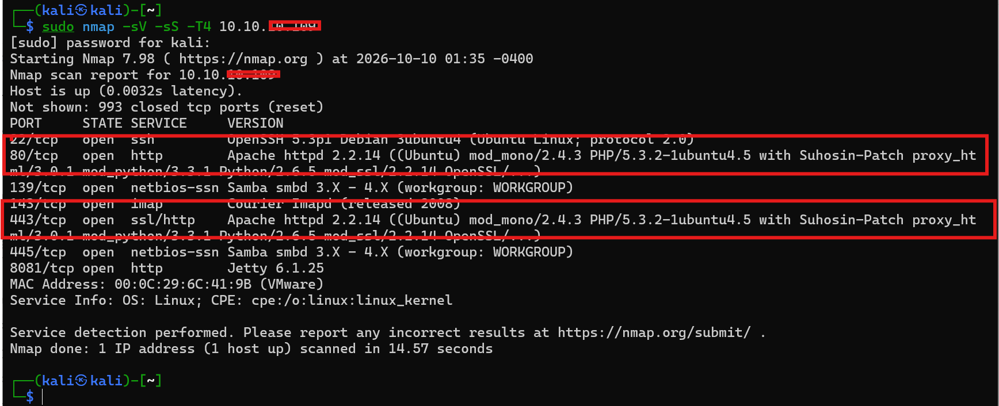

# Part 2: Apache HTTP Server Enumeration and Vulnerability Assessment on OWASP Broken Web Applications (OWASP BWA).

⚠️ **Disclaimer:** This content is published strictly for educational and learning purposes. All commands and techniques demonstrated should only be executed in environments you own or have explicit authorization to test, and within controlled lab conditions. Unauthorized testing of systems, networks, or applications is prohibited. Always obtain the necessary permission and comply with applicable laws and security policies.

**Step 1.**

The exercise starts by running Nmap scan which has confirmed that HTTP and HTTPS are exposed on ports 80 and 443, respectively. We also have an older Apache version to investigate.

**Key observation:** Apache httpd `2.2.14` is an old version. We need to identify applicable vulnerabilities and validate them safely.

**Step 2: Enumerate web directories and files**

Use Gobuster to discover publicly accessible paths on the HTTP service:

gobuster dir \
-u [http://](http://10.10.10.109/)<target host> \
-w /usr/share/wordlists/dirb/common.txt \
-t 20

From the output the web server responds successfully and discloses its software versions and several installed modules. Apache and multiple legacy web applications have been identified. We have potential areas of concern, but no confirmed exploitable Apache vulnerability yet.

**Step 3: Launch Metasploit and search for modules**

search type:exploit apache → in your msfconsole terminal

This lists available exploit modules associated with Apache. Remember, the Apache version reported by Nmap is `2.2.14`, but we haven't established a specific exploitable Apache vulnerability yet.

**Step 4: Investigate CGI and Shellshock.**

Your target exposes `/cgi-bin/` and identifies itself as running Apache 2.2.14. One possible avenue to investigate is Shellshock, a Bash vulnerability that could affect CGI scripts when the server's configuration and script execution environment meet the vulnerable conditions.

Let investigate the CGI directory contents.

**Step 5. Let configure the module now.**

Set the target IP and the CGI script path for your authorized lab:

Oop! Executed the exploit, but this one failed.

I had to retreat back for technology enumeration using whatweb.

Followed by nikto to identify the application versions. This helps in getting actionable targets to decide on which metasploit exploite to use. 

**Next**: Let target myphpadmin module.

exploit/unix/webapp/phpmyadmin_config - This is an older phpMyAdmin configuration-file code-injection exploit. Its age makes it worth investigating on this legacy lab.

Ones again myphpadmin version is hidden, therefore becoming defficult to target, the proceed to joomla.  In joomla we finally have a specific version: Joomla 1.5.15. The page also exposes VirtualMart and XCloner content, which may provide addition avenues for assessment.

Billy! ones again I missed the meterpreter shell..very sad but I must get it. Until next time keep learning!